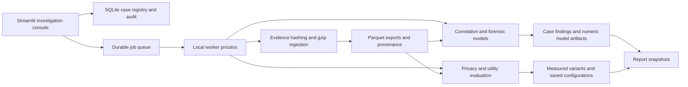

# PrivForensics

PrivForensics is a local forensic investigation and research application. It preserves source evidence, correlates authentication and process observations, and measures what privacy controls change in data exposure, detection utility, and computation. The Privacy–Utility Evaluation Lab keeps those measurements tied to a case, source fingerprint, and reproducible configuration.

## Run locally

The verified environment uses Python 3.15.2 on macOS. The worker also uses POSIX file locking on Linux. Run these commands from the repository root.

```bash
python3.15 -m venv venv
venv/bin/python -m pip install -r requirements.txt
venv/bin/python -B -m pip check
venv/bin/python -B -m pytest -q -p no:cacheprovider
venv/bin/python -B -m streamlit run app.py --server.address 127.0.0.1
```

Open [the local console](http://127.0.0.1:8501). For the optional Presidio text analysis, install the local NLP model with `venv/bin/python -m spacy download en_core_web_sm`. See [verification results](docs/VERIFICATION.md) for the tested paths and measured figures.

The application uses the local operating-system account and defaults to `.privforensics/` for mutable state. To create a separate demonstration workspace, set `PRIVFORENSICS_STATE_DIR` to a private, operator-owned directory before starting Streamlit. The bundled synthetic CSV supports the Lab in a fresh clone. The tests create their own small LANL fixtures. The original LANL archives and their prepared exports are managed locally.

## Demonstration

1. Open **Investigations** and create a case.
2. Open **Privacy–Utility Evaluation Lab** and select **Register synthetic dataset**.
3. In Simple mode, choose **Quick trial** and select **Run experiment** to compare the baseline with masking. Use Advanced mode to compare all five configurations, including differentially private training.
4. Open **Run history** to inspect the measurements. In **Reports**, generate and download an investigation PDF.

### Optional LANL workflow

Use **Simple** for the case checklist, presets and plain-language result summaries. Switch to **Advanced** for model parameters, provenance and full comparisons. Specialist tools contains dataset browsing, event correlation, privacy assessment, diagnostics, performance, audit and settings.

See the [design decisions](docs/design/frontend-decision.md) and [design system](docs/design/design-system.md).


1. In **Investigations**, create a case. In **Evidence Management**, choose **Prepared LANL archives** and register `redteam.txt.gz` first. Inspect the custody entries and queue a SHA-256 check. A local path can also register a large original by reference.
2. In **Evidence Management**, select the registered red-team gzip, choose its LANL schema, and queue bounded ingestion. Open **Dataset Explorer** and select **Case LANL exports**. Inspect the schema, checksum, rejected-line counts, and source-line references.
3. Register all three prepared LANL archives to save complete findings. In **Event Correlation**, inspect a red-team reference timeline and save a finding. For an authentication record, use **Authentication context** to find nearby process activity with a matching account and endpoint. Three completed case ingestions can also be correlated in the background.
4. In **Privacy Threat Analysis**, inspect the synthetic profile or run Presidio on synthetic text. In **Privacy Protection**, choose which fields to mask or pseudonymize and download a protected CSV. **Settings** stores default controls for the active investigation.
5. Open **Privacy–Utility Evaluation Lab**. Register the bundled synthetic CSV, choose **Neural Network**, and queue **E0–E4**. The default E4 budgets are 4 and 8. In **Run history**, inspect metrics, splits, privacy parameters, and the composition ledger. Rerun the saved configuration and use **Compare** to compare matching cohorts. The **Attack Simulation** page displays the recorded synthetic privacy diagnostics.
6. Select **LANL authentication** in the Lab and run E0–E3 with **Random Forest** or **Isolation Forest**. Inspect observed-label average precision, known-positive recall, unlabelled flag rates, and identifier exposure. Use **AI Forensic Analysis** to run or inspect evidence-linked rankings and save a finding.
7. Generate a case snapshot in **Reports**. Download PDF, full JSON, or a section CSV. Review generation and export in **Audit History**.

## Architecture and storage



- `modules/evidence.py` manages references, SHA-256 checks, the upload vault, investigations, and append-only application audit events.
- `modules/jobs.py` and `modules/worker.py` serialize jobs, retain state and results in SQLite, and use checkpoint cancellation. Processing, correlation, and evaluation write through separate services.
- `modules/lanl_reader.py`, `modules/lanl_parquet.py`, and `modules/lanl_correlation.py` preserve physical source lines and archive hashes. `dataset/processed/lanl-v1/` is the local location for large prepared exports. Case ingestions live in the state directory under `processed/`, and case correlations under `correlations/`.
- `modules/lab.py` owns fixed feature recipes, splits, models, accounting, and measured output. `modules/forest_artifact.py` loads bounded numeric JSON for authentication scoring. The console loads the locally generated numeric JSON artifact.
- `modules/investigation.py` and `modules/reporting.py` store cases' profiles, linked findings, and report snapshots. Linked evidence uses a SHA-256 and a one-based physical source line. Exports omit evidence paths and raw LANL account/computer values.
- Back up `registry.sqlite3` and the state subdirectories as a unit while the worker and app are stopped. Treat original evidence retention independently from derived exports. Review the case and its referenced input and output IDs before cleaning up an obsolete state directory.

## Datasets and provenance

The bundled 10,000-row CSV draws labels from documented rules in `dataset/generate_dataset.py`. Preserve the current CSV to reproduce prior runs. Generate a new copy in a separate directory for modifications.

The [LANL cyber1 dataset](https://csr.lanl.gov/data/cyber1/) has de-identified timestamps relative to a dataset epoch. The registered authentication, process, and red-team gzip archives are read in chunks. Parquet manifests record source hashes, physical lines, malformed rows, schema version, and processing duration. A bounded sample identifies its line limit and omits an EOF verification claim. To prepare local exports, obtain the three original gzip files from LANL and put them under `dataset/lanl/`. Run the following from the repository root with enough disk space for the derived Parquet files.

```bash
for feed in auth proc redteam; do
  venv/bin/python -B -m modules.lanl_parquet "$feed" \
    "dataset/lanl/$feed.txt.gz" "dataset/processed/lanl-v1/$feed" --full --reserve-gib 1
done
```

The JSON authentication artifact can be rebuilt from the prepared export without changing archived measurements.

```bash
venv/bin/python -B -m evaluation.run_experiments --kind lanl \
  --output /path/to/new-results --model-output /path/to/lanl_auth.json
```

Supply `PRIVFORENSICS_AUTH_MODEL` to select that local numeric artifact. CLI studies can also use `--kind synthetic` or `--kind process`. For routine verification, the test suite generates small gzip and Parquet fixtures.

## Scientific methodology

- Synthetic classification uses disjoint stratified fit, validation, utility test, and membership nonmember partitions. E0–E3 exclude identifier cells from the model projection. Reported equality in metrics can coexist with reduced direct exposure. Accuracy, precision, recall, F1, ROC-AUC, average precision, FPR, FNR, and confusion counts use held-out synthetic labels.
- LANL authentication uses the same chronological boundaries across variants. Unique exact red-team matches supply observed positives. Ambiguous candidates are excluded. The other events remain unlabelled, so report observed-label average precision, known-positive recall, and unlabelled flag rate. Isolation Forest treats rare behavior as an anomaly score. Time-windowed process context uses identifier matches and an interval, with a separate indication from an exact red-team key.
- E1 masks configured identifier types. E2 produces stable HMAC-SHA256 pseudonyms within their selected domain. E3 mixes both. The Lab uses an ephemeral key because the output is aggregate. To create stable protected exports, put at least 32 random bytes encoded as hex in `PRIVFORENSICS_HMAC_KEY` using your local secret store. An investigation scope prevents joins across cases using the same key. Maintain versioned keys outside the registry and expect newly rotated keys to produce different tokens. HMAC retains within-scope linkage and has no DP budget.
- E4 uses Opacus per-row gradient clipping and calibrated noise, a Poisson loader, and the RDP accountant. Runs record target and spent epsilon, delta, clipping, sample rate, noise multiplier, optimizer steps, and environment. The ledger uses basic composition over completed Lab fits sharing the source SHA-256. The unit is one synthetic event row. Seeded research runs disable secure RNG. Aggregate training diagnostics and baseline results are outside the DP-SGD mechanism. [Opacus Privacy Engine](https://opacus.ai/api/privacy_engine.html)
- Membership diagnostics aggregate true-label confidence with balanced queries and a held-out fold separate from threshold calibration. Linkage uses a generated auxiliary-data fixture whose known records cover half of the targets. The output measures the selected scenarios, with no per-record diagnostic predictions. LANL receives identifier exposure measurements and observed-label metrics.
- Timings come from the worker. The Lab separates data preparation, training and inference. The recorded RSS peaks are sampled at 20 ms intervals and include resident libraries. The CLI's full ingestion manifests report process peak RSS. CPU percentages are process-level and can exceed 100%.

## Reproducibility and troubleshooting

- A run stores its recipe fingerprint, dependency and Python versions, platform, input hash, evidence ID, seed, feature version, split fingerprints and configuration. **Rerun saved configuration** creates a child run. Matching cohorts can be compared, and wall-clock time, CPU, and memory vary between runs.
- Closing a tab leaves queued work in SQLite. If a worker exits, select **Resume local worker** in the selected job view or run `venv/bin/python -B -m modules.worker --state /absolute/state --project /absolute/project`. An interrupted job keeps its configuration for retry. Large ingestions restart against the registered source, and only verified completed exports are published.
- Use SHA-256 verification if an evidence path changes. Case registration never copies the referenced LANL gzip. Full ingestion needs space for its Parquet output and a 1 GiB free-space reserve. Use a bounded sample when validating a new archive.
- The local audit chain supports consistency checks. The OS account controls access to source data and SQLite. Administrators with write access can also rewrite the audit chain. This is a forensic research workspace with record-level experimental privacy accounting.
